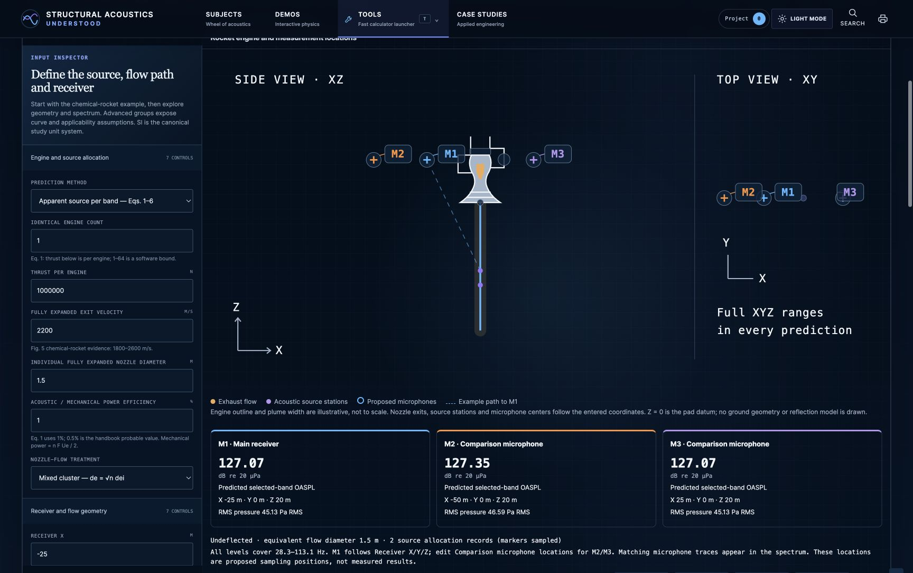

# NASA SP-8072 Launch Acoustic Explorer

Current status: **engine and measurement-location update complete; core software and local browser checks passed**. Results remain preliminary predictions, without measured engine/pad correlation or qualification.

Open `#/tool/nasa-sp8072` in the modular application or generated `standalone.html`. The existing launch-acoustic tool retains its teaching spectrum and designation. The new route uses a separate source dataset, numerical model and adapter, with the shared interactive-analysis layout and `EngineeringResult` contract.

Continue work in `/Users/stephenwells/Documents/DevOps/structural-acoustics-understood`. To open this checkout's updated standalone preview, run `node scripts/sp8072-preview.mjs` and use the URL it prints (default: `http://localhost:4173/standalone.html#/tool/nasa-sp8072`). The launcher starts or reuses a loopback-only server and verifies its served HTML matches this checkout. Runtime PID and log are kept in `tmp/sp8072-preview/`.

The owner selected this original checkout on October 14, 2026. The tested compact layout and typography update has been integrated here; `standalone.html` is regenerated from this folder's sources. The earlier worktree/browser records below are retained as historical evidence. See [checkout integration checks](evidence/original-checkout-integration.json) for the current delivery and backup location.

## Compact panel refinement — October 13

Follow-up typography correction: side/top view headings, microphone labels and diagram axes now use the site's existing monospace technical-label font. The rendered family matches surrounding input labels in standalone/modular pages and dark/light themes. Mobile labels fit without adding page or geometry overflow. See [latest browser checks](evidence/engine-typography-browser-checks.json) and [latest build checks](evidence/engine-typography-build-checks.json).

The engine view now follows the site's engineering panel typography, subdued hardware drawing and compact result language. The side view is primary; a small top-view inset explains out-of-plane separation. Three microphone readouts share a single row on desktop and become compact labeled rows on mobile. Coordinates and predicted levels stay visible; RMS pressure, geometry caveats and source-allocation explanations remain in **Geometry, equations and source basis** and the existing evidence tables.

At 1728 px width, the same two-octave example panel is about 40% shorter (749 px versus the earlier 1264 px). Adaptive framing fits all three microphone labels at 390 px width without horizontal scrolling. Dark/light themes, coordinate updates, error recovery and English pressure details were checked. The full saved example calculation and both numerical source files are unchanged; the suite passes 165/165 and the standalone rebuild is deterministic. See [current browser record](evidence/engine-restyle-browser-checks.json), [build checks](evidence/engine-restyle-build-checks.json), and reproduce software checks with `node scripts/sp8072-verify-style.mjs`.

The following sections and earlier screenshots retain the initial engine-view delivery and its evidence. The updated view is now integrated in this original checkout. Earlier worktree observations retain their recorded scope.

## Engine illustration and proposed measurement locations — initial October 13 update

The geometry view now shows a recognizable rocket engine with feed lines, combustion chamber, throat and bell nozzle, anchored at the calculated nozzle exit. The engine outline and plume width are illustrative, not to scale. Nozzle origins, acoustic source stations and microphone centers follow the entered coordinates. Side (XZ) and top (XY) views distinguish out-of-plane locations; the example dashed path connects the strongest selected-band source contribution to the main receiver. The calculation still sums every source using full XYZ distances and angles.

**M1** follows the existing Receiver X/Y/Z controls. **M2/M3** are proposed comparison microphones, entered as up to two SI coordinate triples in **Comparison microphone locations**. Their default positions, (−50, 0, 20) and (25, 0, 20) m, are demonstration assumptions. Blank input hides comparisons. Each location has a predicted selected-band OASPL, RMS pressure, coordinate card, table row and matching spectrum trace. An excluded near-source or unsupported-angle comparison shows its own error without losing the valid main receiver. These are sampling proposals and predictions, not measured data.

Calculation/study JSON and the report retain all microphone coordinates and predictions. The report includes a readable SI microphone summary; spectrum SVG includes the comparison traces. The existing spectrum CSV continues to describe **M1**. English display converts the cards while coordinate JSON stays explicitly SI. Older studies remain compatible; the original [example study](example-study.json) is unchanged.

For the saved 40/80 Hz octave case (band edges 28.3–113.1 Hz), M1 predicts **127.069 dB**, M2 **127.346 dB**, and M3 **127.069 dB re 20 µPa**. M2 is farther away but slightly louder here because radiation angle changes along with range; Fig. 10 directivity matters as well as spreading.

The current suite passes **165/165**, including 19 SP-8072 checks and five independent analytical benchmarks. Desktop, 390 × 844 mobile, keyboard movement, location errors/recovery, English units, source-method/deflector changes, saved-state reload and HTTP-served standalone parity were checked. The modular tool also reloaded successfully with its task-owned local server stopped. The browser viewport was restored afterward. See [current verification](evidence/measurement-visualization-checks.json), [build and preservation checks](evidence/measurement-visualization-build-checks.json) and [validation notes](VALIDATION.md). Direct-file browser execution, reset dialog, import and print were not automated in this update; earlier evidence and limits are retained below.

## What the model predicts

The outputs are external acoustic band SPL, selected-band OASPL and RMS pressure, referenced to 20 µPa. `surfaceDb = 0` reports the incident free field. An entered surface correction produces an explicitly identified receiver-loading scenario. No structural vibration, internal noise, ignition overpressure or qualification result is calculated.

All displayed bands sum on a linear pressure-energy basis. The stated OASPL covers **only their reported band edges**, not the missing spectral tails. Source power is referenced to 1 pW. Internally, dimensions and studies use canonical SI; supported English display conversions preserve the physical calculation. User-entered coordinate JSON remains explicitly SI in either display mode.

## Implemented handbook procedures

| Procedure | Printed handbook source | Implementation / boundary |
| --- | --- | --- |
| Overall source power and cluster size | Eqs. 1–3, p. 28; §2.1.1 pp. 6–7 | `WOA = eta n F Ue / 2`; default eta = 1% reproduces conservative Eq. 1. F is per-engine thrust. Closely mixed identical nozzles use `de = sqrt(n) dei`. |
| Apparent source per band | Eqs. 4–6, p. 29; Figs. 5, 10, 14, pp. 8, 12, 15 | Fig. 5 density, Fig. 14 preferred solid source locations or closed-bucket dashed locations, Fig. 10 directional radiation, then logarithmic band sum. |
| Distributed source slices | Eqs. 7–10, pp. 30–31; Figs. 11–13, pp. 13–14 | Fig. 11 core length; Fig. 12 slice power; Fig. 13 local spectral density; local range/directivity for every slice. Fig. 5 is not multiplied into this local spectrum a second time. |
| Deflector source-spectrum examples | Figs. 4/8, pp. 7/10 | Selected Fig. 8 curves are relative to undeflected total power and already contain source-generation changes. Fig. 4 efficiency ratios are not stacked. These are historical reference transfers, not universal deflector laws. |
| Vehicle speed | Fig. 16, p. 19 | `20 log10(1−M)` for undeflected subsonic flow. Deflected/moving combinations are refused. |
| Auxiliary spatial correlation | Figs. 17–19, pp. 20–21; §4.2 pp. 31–32 | Entered single-direction normalized-coordinate estimate, with missing correlation outside curve support. No cylinder-scattering or structural-response solution. Fig. 18's theory is for cos beta = 0.1; transfer to other incidence choices remains a scenario. |
| Rough octave loading | Fig. 20, p. 22; §4.2 p. 28 | Inspected and documented, not generalized into an adjustable prediction: the handbook does not recommend it for formal preliminary loads. |
| Measured scaling, experimental prediction | Fig. 2, p. 5; §4.3 pp. 32–33 | No comparable measurement dataset supplied; no correlation or measured scaling result claimed. |

The distributed core relation printed in Fig. 11 is `xt/de = 3.45 (1 + 0.38 Me)^2`. Exhaust sound speed is derived consistently as `ae = Ue / Me`; ambient sound speed is independent. The printed Eq. 8 has `+ log Deltaf`; linear power-density conversion requires `10 log Deltaf`, consistent with Eq. 4. The tool uses linear-power conversion and records this interpretation. Spherical spreading retains the handbook's rounded −11 dB constant.

At fixed thrust, acoustic source power varies with `eta * Ue`. The cubic velocity law arises when an ideal pressure-matched jet's thrust also changes as `rho A Ue²`; it is not a separate multiplier to add to Eq. 1. Changing nozzle diameter or cluster treatment also shifts spectral similarity and source geometry, so a receiver need not follow a point-source distance rule near the extended flow.

## Controls and assumptions

[CONTROLS.md](CONTROLS.md) inventories all 68 adapter controls, their canonical units, defaults, software bounds, options and source basis. The manifest also includes every digitized ordinate and the numerical bounds. Model-specific fields are hidden when inapplicable. The tool exposes identical engine clusters, independent nozzle coordinates, split branches, geometry, both spectral procedures, custom density curves, directivity alternatives, source-position/core multipliers, numerical slicing, bandwidth, water scenarios, path/receiver corrections, velocity and auxiliary correlation.

Software limits include 1–64 identical engines, 8–512 slices, at most 128 bands and 4096 allocated source records. These are resource limits, not empirical validity ranges. Mixed engine types, arbitrary plume-merging transitions and coupled vehicle/pad trajectories are not modeled. Ambient pressure, temperature and composition are represented only through entered sound speed/density and the pressure-ratio applicability check; the tool does not invent independent thermodynamic noise corrections.

The default is an illustrative standard chemical rocket: one engine, 1 MN thrust, 2200 m/s, 1.5 m diameter, 1% efficiency, receiver (−25, 0, 20) m, and third-octave centers from 20 to the last center below 400 Hz. These are not a claimed measured engine or pad. The curve evidence for Fig. 5 spans 1800–2600 m/s; departure requires custom data or explicit scenario transfer. Significant exhaust/nozzle/pressure/density departures trigger the handbook testing boundary (§3.3.1 p. 26).

## Water and deflectors

Selectable configurations include undeflected flow, smooth open and closed buckets, twin flows, covered tunnels, flat plates at 6 and 22 diameters, a curved plate, a 150° bucket, and a conical geometry requiring a user spectrum. Turning angle, stand-off, azimuth, bend radius and branch power share are adjustable. A circular bend and simplified opposing branches represent entered geometry; they are not resolved plume/impingement solutions. A deflector can increase receiver loading by redirecting radiation or moving sources nearer even when source power decreases.

Water mode is an **entered incremental source-reduction scenario relative to the same reference deflector**, using a broadband value or a frequency curve plus provenance. Water flow, exhaust mass flow, injection location, angle, pressure and injector diameter are usable saved controls, but do not automatically create a dB credit. Exhaust flow can be entered or estimated from nozzle area, density and velocity. Turning water off restores the reference calculation. Fig. 8's historical water conditions are not established here, so an added wet/dry reduction must be incremental to that reference, not another copy of a total correction.

[SP-8072 §2.4 pp. 23–24 and §4.4 p. 34](https://ntrs.nasa.gov/api/citations/19710023719/downloads/19710023719.pdf) supplies configuration-dependent suppression examples, not a universal flow-ratio law. [Allgood et al. (2014)](https://ntrs.nasa.gov/citations/20140005349), locally retained and inspected, studies a subscale altitude diffuser with different injection locations, angles, sizes and flows; excessive water can unstart that diffuser. [Henderson (2010)](https://ntrs.nasa.gov/citations/20100042122) was consulted as a NASA abstract only. Its optional full-text URL returned HTTP 404 and NTRS lists no available download. No reduction coefficient was transferred from either supporting source. Historical references 42 and 43 were identified but not independently retrieved.

The calculation stages are source generation → allocated/deflected source geometry → path propagation → receiver loading. A shielding interval attenuates selected distributed source paths once; the apparent-source method refuses shielding or covered tunnels. Additional reflection and surface correction are separate entered scenarios. A measured total receiver reduction must not be entered simultaneously as source and path reductions.

## Curve transcription and bandwidth

The official PDF is retained unchanged at [NASA-SP-8072-19710023719.pdf](../../references/NASA-SP-8072-19710023719.pdf). Its SHA-256 and page mapping are in [sp8072-manifest.json](../../references/sp8072-manifest.json). Printed page p corresponds to zero-based PDF index p + 7.

Sparse manual points follow the faired curves, not the scattered measured symbols. Density interpolation is linear in log-abscissa/dB ordinate; each interval is a power law whose integral is evaluated analytically. An alternative center-density × bandwidth convention implements the handbook approximation. Third-octave and octave bands use base-2 geometric edges; linear bins can use 1 Hz width. Fig. 14 interpolates log/log; Fig. 10 interpolates linear angle and logarithmic Strouhal number. The nearest tabulated Strouhal directivity extension is an explicitly labeled scenario; unsupported angles fail unless an entered/isotropic scenario is selected.

Density tails outside the inspected support are omitted and warned, never silently extrapolated or normalized away. Apparent-source positions outside their curve domain fail. Fig. 13's dashed low-frequency portion is explicitly warned. Estimated reading errors (not independent certified uncertainty bounds) are about ±1–1.5 dB for density/directivity and ±12–15% for apparent positions. Raw domain integrals are 1.0686294 for Fig. 5, 0.9268807 for Fig. 12 and 0.8477724 for Fig. 13; their departures from unity remain visible in provenance and captured fractions.

## State and exports

The shared version-1 browser-local study provides automatic persistence, reset, identity/version validation, baseline metrics/spectrum and project evidence. Rapid input edits commit immediately before debounced rendering so a later field cannot cancel an earlier value. Imported baselines are recomputed from their canonical inputs. Inactive custom/water curve drafts do not block handbook or dry recovery; active invalid curves fail explicitly. The study exporter uses the established DOM-attached download helper and includes the current canonical calculation for this adapter.

Calculation JSON, spectrum CSV, plain-text report and spectrum SVG controls preserve source version and assumptions; project evidence retains the canonical input/result record. JSON/report calculations remain SI even when the screen uses English units. [example-study.json](example-study.json) is the unchanged, hash-verified reproducible two-octave case. Two earlier study exports and **all five fresh exports** (study/calculation JSON, CSV, report and SVG) were saved and verified. Fresh files were saved inside the project through Chrome's native Save dialogs. [Fresh export checks](evidence/fresh-export-checks.json) record input agreement, exact level agreement, CSV pressure-energy closure, SVG band data and file hashes. Earlier download-event timeouts or immediate missing-file observations did not establish failed downloads. The final wrapping mobile captions were also visually verified.

All essential numerical data and explanations are embedded in generated standalone HTML and registered in the modular offline cache. Static embedding/build checks passed. Modular desktop and 390 × 844 mobile controls, state restoration, repeated keyboard movement, numeric-input recovery and spectrum layout were exercised. The desktop spectrum spans the evidence grid; on narrow screens its focusable chart region supports horizontal keyboard panning. Query-bearing shared routes reapply their inputs on reload; the normal route restores saved local state.

Direct-file browser opening was denied because this browser surface permits only HTTP/HTTPS protocols. Actual standalone/offline operation remains untested. Reset/dialog handling and viewport cleanup timed out, so their final state is unconfirmed. The tool remains a partial delivery with explicit access blockers; see [VALIDATION.md](VALIDATION.md) for the exact failures and evidence boundaries.

The reset recheck again hit dialog-handling timeouts. Automatic approval review denied raw CDP recovery on the same localhost origin; the check stopped without a workaround after that rejection. Import/print/offline rechecks were not reached, and the local QA tab is retained for manual inspection. No successful reset, viewport cleanup, direct-file delivery or owner acceptance is inferred from the verified exports.

## Historical handoff preserved below

The following unmodified text records the initial blocked research pass. Its status and absence-of-data statements are historical, superseded by the implementation and evidence above.

---

# NASA SP-8072 explorer — research handoff

Status: **blocked; explorer not implemented**. This document records a partial source review, not an accepted model contract or a delivered prediction tool.

## Source access and blocker

The text of [NASA SP-8072, Acoustic Loads Generated by the Propulsion System](https://ntrs.nasa.gov/api/citations/19710023719/downloads/19710023719.pdf) was retrieved with the public research tool. Printed pages and PDF page indices differ: printed page 28 is PDF page 36 (zero-based index 35). The PDF contains 58 pages.

The required curve images were not available in the returned research output. Opening the PDF in Chrome was rejected by browser security policy, with the stated reason that permission for `ntrs.nasa.gov` had been denied. A prior shell download failed with `curl: (6) Could not resolve host: ntrs.nasa.gov`. No escalation, alternate browser, or workaround for the denial was attempted. There is no local handbook PDF in this checkout's references directory.

Numerical curve digitization, independent prediction benchmarks, and a source-supported implementation therefore remain open. In particular, interpolating imagined ordinates or copying the existing launch tool's teaching spectrum would not satisfy this assignment. The manifest explicitly records absent data.

## Calculation inventory recovered from the handbook text

The predicted quantity is external acoustic pressure loading, expressed as band SPL and overall SPL referenced to 20 µPa. Structural vibration and internal acoustic response require additional models (printed pp. 1–3). Source power uses a 1 pW reference. Band levels must remain distinct from spectral density.

| Procedure | Source location | Necessary source data | Current coverage |
| --- | --- | --- | --- |
| Single apparent source per frequency band | §4.2, Eqs. (1)–(6), pp. 28–29 | Figs. 5, 10, 14 | Equations reviewed in text; curve ordinates absent |
| Distributed slices of the exhaust flow | §4.2, Eqs. (1)–(3), (6)–(10), pp. 28–31 | Figs. 10–13 | Equations reviewed in text; curve ordinates absent |
| Similar-configuration rough octave estimate | §2.3.1 and §4.2, Fig. 20, pp. 19–22, 28 | Configuration-specific Fig. 20 contours | Not inspected; handbook does not recommend it for formal preliminary loads definition |
| Spatial correlation | §4.2, pp. 31–32 | Figs. 17–19 | Geometry and correlation curves not inspected; no correlation implementation |
| Liftoff geometry and vehicle speed | §2.2, Fig. 16, pp. 16–19; §4.2, p. 32 | Fig. 16; relocated nozzle and deflector geometry | Curve not inspected; no trajectory or moving-receiver implementation |
| Reflections and vehicle surface loading | §4.2, p. 31 | Installed geometry or measured correction | No universal reflection or cylinder-scattering calculation supplied here |
| Geometric scaling and experimental prediction | §2.1, Fig. 2; §§4.3.1–4.3.2 | Comparable measured spectrum and scale factors | Not implemented |

For the recommended conservative source estimate, Eq. (1) gives `W_OA = 0.005 n F U_e`, with per-engine thrust `F` in N and fully expanded velocity `U_e` in m/s. This is **1% acoustic efficiency of mechanical power `n F U_e / 2`**, not 0.5%. Eq. (2) gives `L_w = 10 log10(W_OA) + 120`. Eq. (3) uses `d_e = sqrt(n) d_ei` for the combined flow of identical nozzles. Fig. 5 must be converted from normalized density into the chosen bandwidth using Eq. (4), without normalizing a truncated displayed spectrum to full power.

Eqs. (5) and (9) give `SPL = L_w,band − 20 log10(r/m) − 11 + DI`. The handbook's rounded `−11` convention must be identified if an implementation instead uses `−10 log10(4π)`. Eqs. (6) and (10) sum powers logarithmically. The distributed method obtains slice power from Fig. 12 and slice spectral density from Fig. 13; it must not reuse Fig. 5 as a second independent spectral multiplier. Receiver distance and angle are derived separately for each source and local flow direction.

## Independent-variable coverage to resolve

This is a research inventory, not a set of approved defaults. Software bounds must be distinguished from empirical applicability bounds.

| Group | Independent inputs or required scenario data | Derived quantities and evidence boundary |
| --- | --- | --- |
| Source generation | Engine count; per-engine thrust (N); fully expanded exit velocity (m/s); nozzle exit diameter (m); optional measured acoustic efficiency (%) | Mechanical power, acoustic power, sound-power level, and equivalent diameter. Close mixed clusters and separated flows require different geometry; a count alone cannot represent arbitrary nozzle layouts. |
| Distributed method | Exit Mach number; ambient sound speed (m/s); exhaust sound speed (m/s); slice extent and numerical resolution | Core length from Fig. 11; normalized slice power from Fig. 12; local spectrum from Fig. 13. Exit velocity, Mach, and exhaust sound speed must be physically consistent. Slice truncation and refinement need explicit closure checks. |
| Spectrum | Band convention; frequency range (Hz); user-supplied measured spectrum when handbook similarity fails | Strouhal number, exact band edges, bandwidth, captured source-power fraction. Hydrogen exhaust examples in Fig. 6 cannot be represented by silently extrapolating Fig. 5. |
| Flow and receiver geometry | Nozzle coordinates; deflector stand-off (m); outlet flow direction; branch geometry and allocation; receiver coordinates (m); liftoff height (m) | Source coordinates along the flow path, range (m), and angle from local flow direction (deg). Reject receiver–source coincidence and obstruction treatments incompatible with the apparent-source method. |
| Propagation | Measured directivity override; source/path-specific shielding or attenuation; reflector geometry or identified scenario correction | Fig. 10 supplies frequency-dependent directivity. Using it for local sources is an empirical assumption. Do not turn a roof or arbitrary obstruction into a universal dB credit. |
| Receiver loading | Vehicle surface orientation and scattering treatment; optional explicitly entered surface correction | Incident free-field pressure and surface pressure are different outputs. A structural response must not be inferred from either. |
| Applicability metadata | Exit density (kg/m³); exit/ambient static pressure; nozzle shape and area ratio; nozzle spacing/layout; shroud; ambient temperature/pressure/composition; vehicle velocity | These matter in §§3.2–3.3 even when absent from Eqs. (1)–(10). They require warnings, extra data, or a different model rather than fabricated algebraic sensitivity. |
| Water | Dry/wet selection; water mass flow (kg/s); exhaust mass flow (kg/s); injection location and configuration; explicitly entered source reduction spectrum | Water/exhaust ratio is derived. The handbook provides examples, not a universal reduction-vs-ratio law. Metadata must not create a numerical reduction by itself. |

Fig. 5's chemical-rocket velocity range is 1800–2600 m/s (pp. 8–9). Sections 3.3.1 and 4.3 identify test requirements for unusual engines, nozzles, atmospheric conditions, and deflectors. Limits such as exit velocity above 3000 m/s, pressure ratio above 2, or exit density outside the stated range must not be treated as proof that all remaining cases are validated.

## Water and deflector evidence boundaries

Figures 4 and 8 (pp. 7, 10) identify undeflected flow, flat plates, curved plates, conical deflection, and bucket configurations. Their measured acoustic efficiencies and spectra depend on the tested engine and stand-off. Fig. 14 distinguishes open-scoop and closed-bucket apparent-source locations. Turning the flow also changes receiver range and directivity; it can increase receiver loading despite lower total source power. No Figure 4 efficiency or Figure 8 spectral ratio has been digitized here.

The handbook discusses twin deflected flows separately on p. 31. A double deflector requires separately allocated power and geometry for both branches, not two copies of the full source. A covered bucket or tunnel introduces shielding; the distributed source method is required when shielding matters. A chosen geometry alone does not establish its attenuation.

Section 2.4 (pp. 23–24) and §4.4 (p. 34) discuss water injection, immersion, deflector turning, shielding, and reflections. References 42 and 43 are identified but have **not been independently retrieved**. The reported water examples are configuration-specific; no continuous suppression law or universal water/deflector combination can be inferred. A future scenario mode may accept a user-entered reduction curve with provenance, apply it to source power once, and retain a dry comparison. Such a mode would be an assumption, not an empirical water-flow prediction.

Separate the calculation stages as source generation → allocated/deflected source geometry → path propagation → receiver surface loading. A measured total wet/dry receiver correction cannot also be applied as an independent source correction and a path correction. Combined treatments need a stated common baseline and overlapping mechanisms checked.

## Integration review

Read: `docs/engineering-tool-design-guidelines/README.md`, `js/workbench-runtime.js`, `js/engineering-results.js`, `js/engineering-results.d.ts`, `js/engineering-workbenches.js`, `js/acs519-calculators.js`, `js/app.js`, `service-worker.js`, `scripts/sync-standalone.mjs`, `js/unit-system.js`, and the relevant registry tests.

The existing `launch-acoustic-source` explicitly labels its broadband spectrum as a teaching envelope. It must remain available. A future `nasa-sp8072` adapter can use the shared interactive-analysis profile, grouped controls, local study state, reset/import/export, baseline metrics, charts, and project evidence. Dedicated data and physics modules should contain handbook curves and numerical procedures. The standalone generator wraps modules explicitly, so each dependency must be added to the generator and offline cache. No generator or application edits were made during this blocked research pass.

## Required digitization record

For each selected curve: retain figure and printed page, curve identity, axis transform, calibration coordinates, sampled ordinates, estimated reading uncertainty, interpolation rule, valid domain, and tail policy. Recommended implementation practice is interpolation in the coordinates actually plotted (usually log abscissa and dB ordinate), with linear-power integration over real band edges. This is a proposed numerical practice, not a handbook-prescribed digitization algorithm. Refuse unsupported extrapolation or require an explicitly identified user curve. Do not renormalize missing tails without reporting the alteration.

See [the manifest](../../references/sp8072-manifest.json) for machine-readable coverage and [VALIDATION.md](VALIDATION.md) for the verification boundary.
