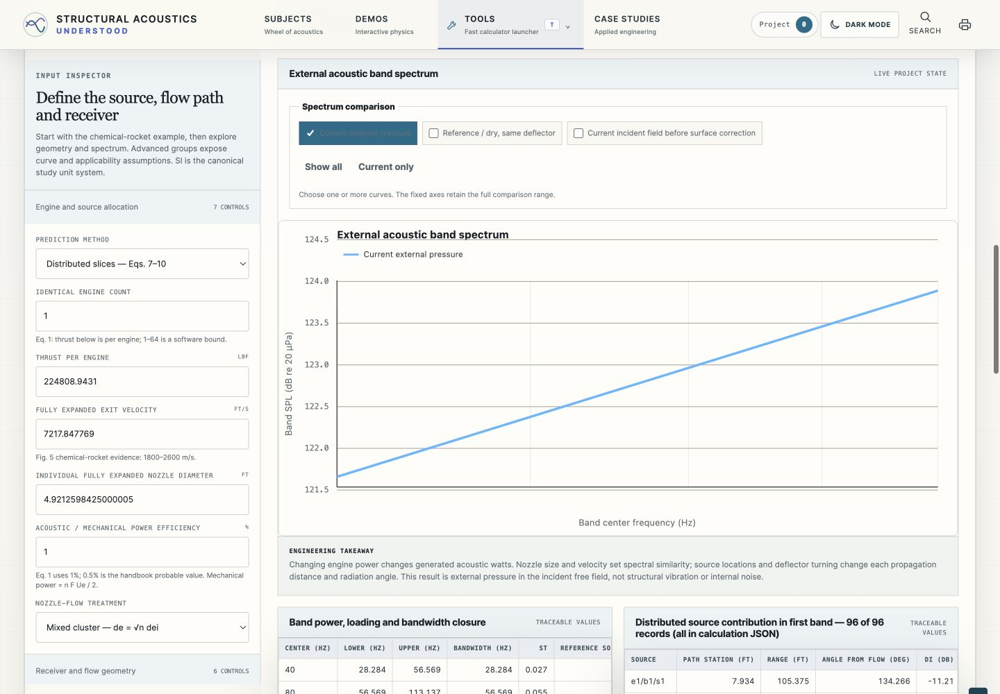

# SP-8072 validation and delivery handoff

Current status: **requested engine and microphone visualization delivered and core software/browser behavior checked**. Neither measured engine/pad correlation nor qualification is claimed. Historical delivery checks below retain their original scope and limitations.

## Engine and microphone update — October 13, 2026

Added an editable inline SVG rocket engine, XZ/XY projections, M1 main receiver and up to two user-entered comparison microphones. Every location independently runs the existing prediction model with full XYZ geometry. Cards, spectrum traces and the location table share the calculation; JSON and text reports preserve all locations. The existing CSV remains the main receiver spectrum. Engine outline and plume width are marked as illustrative; source-station markers are distinguished from proposed microphones.

**Software:** 165/165 application tests pass, including 19 SP-8072 tests. The new tests independently check the two known apparent-source ranges when receiver Y changes, per-location pressure-energy closure, invalid-comparison isolation, coordinate validation, old-study compatibility, SI/English display, report text and JSON/SVG content. Five independent analytical benchmarks pass. Standalone generation is deterministic and `git diff --check` passes. The earlier owner-file and imported-PDF hashes and the original example-study hash are preserved. See [build checks](evidence/measurement-visualization-build-checks.json) and [full test output](evidence/measurement-visualization-tests.txt). Reproduce with `node scripts/sp8072-verify-visualization.mjs`. The verification script preserves the starting Flight Response bytes in the current checkout; historical owner hashes remain in the earlier evidence records. Imported PDF and original example hashes are still checked against their recorded provenance.

**Observed in Chrome from this checkout, localhost:4178:**

- The 40/80 Hz octave case shows M1 **127.07**, M2 **127.35**, M3 **127.07 dB re 20 µPa**, matching precise calculated levels 127.06875418001745, 127.34587472013351 and 127.06875418001745 dB. The spectrum has matching labeled traces and the cards display SI coordinates and RMS pressure.
- Doubling thrust gives **130.08 / 130.36 / 130.08 dB**, consistent with a 3.0103 dB increase. Moving M2 to Y = 15 m gives **127.33 dB** and a different top-view Y position. M1 remains unchanged.
- A comparison at the 40 Hz apparent source fails the minimum-range condition and displays **Unavailable**. M1 and M3 stay valid. Restoring the coordinates recovers M2.
- English display keeps the levels and converts coordinates/pressure to ft/psi RMS. Distributed sources give **126.00 / 126.20 / 126.00 dB**. The smooth open-bucket preset gives **127.70 / 123.87 / 142.75 dB**, matching the model; directed radiation and source geometry change the spatial pattern.
- Keyboard Enter on Receiver +X moves only M1 from −25 to −24 m and gives **127.03 dB**; reload retains this coordinate and level. Receiver −X restores the saved example.
- At **390 × 844**, document width equals 390 px. The geometry has a 364 px viewport and 680 px content, with horizontal keyboard movement and retained focus. The cards stack at 332 px width. Desktop viewport **1728 × 1084** was restored and observed. These are emulated mobile dimensions, not physical touch-device checks.
- The generated standalone HTML served over **HTTP** shows the same engine and all three levels/traces. This does not establish direct-file execution.
- The task-owned server was stopped, and command HTTP access failed with connection refused. The modular browser page then reloaded successfully from the offline cache with the engine, microphone inputs and all three levels. The server was restarted. This establishes recovery when the local origin is unreachable; global Wi-Fi was not changed.

The comparison-spectrum legend now uses readable theme text, and explicit endpoint labels keep the 40/80 Hz log axis readable. The opt-in endpoint labels leave other plots unchanged.

The offline cache is now `sau-v137-sp8072-measurements`. An initial reload during cache activation retained the old text-anchor style; the subsequent reload showed the corrected labels. [Browser record](evidence/measurement-visualization-checks.json), [desktop image](evidence/engine-measurements-desktop.jpg), [mobile geometry](evidence/engine-measurements-mobile.jpg), [mobile cards](evidence/engine-measurements-mobile-levels.jpg), [HTTP standalone](evidence/engine-measurements-standalone.jpg) and [offline image](evidence/engine-measurements-offline.jpg) retain the observed evidence.

Actual downloads were not repeated in this update; report/JSON/SVG content was checked in tests and a [new calculation record](evidence/measurement-example-calculation.json) and [readable report](evidence/measurement-example-report.txt) were generated locally. Earlier actual-export evidence remains below. Reset dialog, print preview and direct-file/import browser automation were not retried. The owner-observed standalone import below remains separate evidence. No imported PDF or original example was edited, and no source download, publication or upload was performed during those browser checks. The later owner-approved original-checkout transfer and Git delivery are separate from that browser evidence.

## Earlier checks and recovery history

## Owner-supervised recovery and final follow-up (October 13, 2026)

CoS recovered the original CLI report and all 51 reported regular files after removing
its old artifact-count rejection. Original report bytes are preserved separately from
follow-up observations; file snapshots reflect recovery time. No worker was relaunched
and no result was accepted.

The owner confirmed that manual study import worked in the directly opened standalone
tool. This is owner-observed evidence, recorded in CoS project context, rather than an
automated import pass. The earlier automated import/direct-file denials below remain
historical and were not bypassed.

The final pressure-label browser check exposed stale code in the existing v133 offline
cache. The cache version is now `sau-v134-sp8072-final`. After activation and reload,
the retained Chrome modular tab showed **131.926 dB** with an entered 6 dB reflected-field
gain, compared with **125.926 dB** without it. The value note reads **Incident pressure
with entered path corrections**, and the physical interpretation also names those
corrections. See [final-pressure-label.png](evidence/final-pressure-label.png) and
[the DOM observation](evidence/final-pressure-label-check.json).

The current application suite passes **162/162**. The standalone rebuild is deterministic
and `git diff --check` passes; [the build check](evidence/final-recovery-build-checks.json)
records the hash. These checks establish software behavior, not measured engine/pad
correlation or empirical-curve qualification.

The actual **Print report** click timed out in browser input dispatch; subsequent page
observation was blocked. Print layout remains inconclusive. The documented viewport
reset returned successfully, but its resulting dimensions could not be observed after
the print interruption. No further reset-dialog action or direct-file navigation was
attempted. The owner has been asked to confirm **Reset to baseline**, **direct-file reload
and control interaction with Wi-Fi off**, and **readable print preview**. These checks
remain open until actual observations arrive. [final-followup-checks.json](evidence/final-followup-checks.json)
separates passed, historical denied, inconclusive and pending owner checks.

## Latest resumed checks

Native app access no longer reported a locked Mac, and the initial JavaScript-dialog inspection found no unfinished confirmation. The final saved geometry implementation loaded with its 900 × 350 viewBox and wrapping HTML captions. A fresh 390 × 844 screenshot verifies readable, unclipped captions and a 390 px document width: [resumed-mobile-geometry.png](evidence/resumed-mobile-geometry.png). This supersedes the earlier caption recheck limitation below.

**Five fresh actual exports passed:** study JSON, calculation-evidence JSON, spectrum CSV, text report and spectrum SVG. Each actual app control was clicked once. Chrome opened a native Save dialog; each new file was saved inside this project's evidence folder. The JSON inputs, saved calculations and report record agree; CSV band values agree and independently sum to **125.92632640937516 dB**, matching the visible rounded **125.926 dB**. The SVG contains the correct 40–80 Hz domain and band-point titles. The screen used English units while the calculation/report/CSV retained their stated canonical SI references. See [fresh-export-checks.json](evidence/fresh-export-checks.json), reproduced with `node scripts/sp8072-verify-exports.mjs`.

The earlier export observed as absent was also subsequently found as `nasa-sp8072-project (3).json`. During this resumed click, the native Save dialog was directly observed; download-event timeouts or an immediate missing-file observation cannot establish failed delivery. A native AX observation timed out after saving the calculation-evidence file, but its actual saved payload passed the checks. Raw downloaded evidence files are retained without editing their contents.

The **reset recheck remains blocked**. The Reset click timed out waiting for `Input.dispatchMouseEvent`; the documented JavaScript-dialog helper then timed out waiting for `Emulation.setFocusEmulationEnabled.confirm`, and native observation also timed out. Automatic approval review rejected the same-tab recovery action `Page.handleJavaScriptDialog` (`accept=true`): **“The user declined permission for this action. Browser use cannot use raw CDP on http://localhost:4173 because the user denied permission for this request.”** That recovery check stopped without a workaround after rejection. No successful reset or viewport restoration is claimed. The local QA tab is retained for handoff; its confirmation state needs manual inspection.

The exact-file import recheck, print layout and actual offline reload were not reached after this reset-recovery denial. The previous direct-file URL-policy rejection remains unresolved and was not bypassed. The old task-owned server session is no longer available (`Unknown process id 7760`); no alternate process inspection or server shutdown was used. [resume-checks.json](evidence/resume-checks.json) separates this fresh evidence from the earlier chronology below.

The coordinator has reported `Invalid completion artifacts` again after the file-only report. The local file audit cannot establish the coordinator's private validation rule or stored payload. A directory entry in the original report was a real reporting defect, but it is not established as the sole cause of subsequent rejections. No coordinator code or files outside the approved project were accessed.

A final adapter label correction identifies entered reflection/shield/absorption cases as incident pressure with entered path corrections, instead of describing those cases as a free field. Focused checks verify a 6 dB reflected-field gain without changing source watts and verify the pressure-basis label. This conditional label was not rechecked in the browser after the reset-recovery denial; the exported zero-path-correction case is unaffected.

## Passed checks

The latest full application suite passed **162/162**, with zero failures, skips or cancellations. It includes 16 focused SP-8072 tests plus the existing 146 checks. The original resumed-run failure (145/146) was the stale offline-cache version assertion; it was corrected for the new cache and the new modules are explicitly asserted. The earlier rapid-edit browser failure was fixed in the shared runtime and then checked with two fields edited in quick succession. A later focused regression verifies that inactive malformed curve drafts permit handbook/dry recovery while active invalid curves fail.

The focused suite covers both recommended source-allocation procedures; power/reference units; exact power-law density integrals; logarithmic source and band sums; pressure-variance and source-contribution closure; truncated source power without hidden renormalization; domains and singular geometry; source and branch allocation; continuous bends; slice refinement; dry recovery; exact incremental water scenarios for every available non-custom deflector preset; path shielding versus surface loading; 1 Hz bins; no silent resource truncation; unit round trips; study identity/version; result schema; retained baselines; cache dependencies and standalone script parsing.

Five independent analytical cases are retained in [the benchmark fixture](../../tests/fixtures/sp8072-benchmarks.json), regenerated by `python3 scripts/sp8072-benchmarks.py`. That script imports no implementation or source-data module. Constant diagnostic spectral densities isolate mechanics. The distributed reference is an analytical continuous axial receiver integral, not the implementation's slice algorithm. These artificial cases establish software correctness, not empirical curve accuracy.

| Case | Reference selected-band OASPL (dB re 20 µPa) | Absolute numerical error (dB) | Tolerance (dB) |
| --- | ---: | ---: | ---: |
| Apparent source, undeflected | 147.980085372913 | 0 | 1e-8 |
| Apparent source, open turn | 149.290311178479 | 2.84e-14 | 1e-8 |
| Apparent source, closed locations | 151.664002890492 | 0 | 1e-8 |
| Apparent source, symmetric twin branches | 149.290311178479 | 2.84e-14 | 1e-8 |
| Distributed continuous axial integral | 144.342777524139 | 1.5243e-5 | 0.002 |

The algebra tolerance allows floating-point evaluation error only. The 0.002 dB distributed tolerance permits finite-slice approximation of the independent integral. Neither tolerance represents the handbook's prediction uncertainty or source-curve reading error. [numerical-checks.json](evidence/numerical-checks.json) retains the actual values and comparisons.

## Browser evidence actually obtained

This section preserves earlier checks. The latest resumed checks above supersede its absent-download and unperformed-caption statements.

Chrome, modular route `http://localhost:4173/#/tool/nasa-sp8072`:

- Default third-octave result: **131.577 dB**; doubled thrust: **134.588 dB**; retained baseline comparison present.
- Open-deflector configuration with doubled thrust and an entered 6 dB incremental water source scenario: **129.231 dB**; no universal water-flow relation used.
- Distributed-source switch at the same wet setup: **126.659 dB**.
- Empty receiver-X field displayed `receiverX: enter a finite number`; restoring the field recovered the result.
- Keyboard Enter on Receiver +X changed −25 to −24 m and updated the result to **126.853 dB** for the distributed wet setup.
- English display preserved the SPL, converted RMS pressure to psi and restored state on reload.
- Rapid edits of water provenance and reduction were both retained after the fix. Previously, one pending input could be lost when another canceled the shared debounce; that observed failure is recorded and resolved.
- A reproducible two-octave route (`fmin=40&fmax=80&band=octave`) produced **127.069 dB**, matching the locally generated example study (127.06875418001745 dB).
- Desktop hero, inspector and linked geometry were captured at a 1440 × 1000 viewport in [modular-desktop.png](evidence/modular-desktop.png) and [modular-wet-distributed.png](evidence/modular-wet-distributed.png). These snapshots precede the last cosmetic/export-record refinements; they do not validate every pixel of the final build. The temporary viewport override was reset.
- The resumed desktop plot check exposed shared-chart clipping at narrow container widths. The SP-8072 plot now spans both desktop evidence columns. A fresh screenshot verifies the full chart in [modular-final-spectrum.png](evidence/modular-final-spectrum.png); its client and scroll widths were both 977 px. A [geometry view](evidence/modular-final-geometry.png) was also captured.
- At **390 × 844**, the mobile page and document widths both measured 390 px. Controls stack without page-level horizontal overflow. The spectrum is an intentionally scrollable region (328 px client width, 680 px content width): two ArrowRight presses moved it to an observed 30.5 px scroll offset with focus retained. See [mobile controls](evidence/modular-mobile.png) and [mobile spectrum](evidence/modular-mobile-spectrum.png). This is viewport emulation, not physical touch-device testing.
- On the mobile setup, two Enter presses moved Receiver X from −25 to −23 m and retained button focus. Tab moved Receiver X focus to Receiver Y. Empty Receiver X showed `receiverX: enter a finite number.`; restoring the field recovered **125.926 dB** for the two-octave distributed case at X = −23 m.
- Rapid edits retained both the entered water-scenario basis and the 6 dB reduction. A twin distributed-flow scenario at X = −23 m gave **132.004 dB** over the two octave bands. Water flow remains metadata; the user-entered reduction is not a measured flow law.
- The normal route restored X = −23 m, distributed method, English display and **125.926 dB** on reload. A query-bearing route deliberately reapplies its supplied inputs on reload, overriding saved local state.
- Two recovered actual study downloads contain saved calculations of **126.85309898067239 dB** (distributed wet study with a retained baseline) and **127.06875418001745 dB** (40–80 Hz octave study). Both parse as the correct version-1 tool study and match fresh model calculations exactly, with zero dB difference. The older original export has retained baseline evidence but no current `calculation` field. See [download-checks.json](evidence/download-checks.json) and the unmodified [recovered two-octave payload](evidence/recovered-study-export.json).

The [browser record](evidence/browser-checks.json) separates observed behavior, policy blocks, harness failures and unperformed checks. The last inactive-curve recovery change was covered by numerical tests; it was not subsequently checked in the browser after reset/dialog handling timed out. Review of the saved mobile geometry image exposed clipped SVG caption text and excess empty space inherited from the shared layout. Captions were moved to wrapping HTML, and the SP-8072 schematic now uses its natural height. The saved geometry screenshots precede this correction; the final caption/layout browser recheck was not performed.

## Failed or blocked checks

The chronology below records the earlier run. Fresh file delivery is now verified above; reset, import/direct-file and offline blockers remain separate.

Earlier study-export **download-event verification timed out after 10 seconds**, but the recovered files establish that those two export clicks did produce valid downloads. The timeout is a harness limitation, not evidence of absent files. In this resumed check, task-specific Downloads names, byte counts and modification times were recorded before a single actual Export click. No new matching file was observed afterwards. No application-origin console error was captured. CSV, report and SVG delivery was not subsequently tested. Native app observation returned: **“The Mac is locked and automatic unlock could not unlock it.”** No native download-dialog state is inferred from that error.

The owner renewed approval for only `docs/sp8072/example-study.json` at the exact two-octave localhost destination. Its SHA-256 was verified as **3ffc6263728b4a70b96dc37c31b6711dbcc53a16ef37071249d0f87028037c5a**, and the file was left unchanged. The documented chooser flow used the same Chrome surface and existing tab. Automatic approval review still rejected `fileChooser.setFiles`: **“The user declined permission for this action. Browser use cannot upload files to http://localhost:4173/#/tool/nasa-sp8072?fmin=40&fmax=80&band=octave because the user denied permission for this request.”** This import check stopped. No alternative browser surface, raw-CDP upload, pasted-state workaround or permission escalation was used. The browser import/round trip remains blocked.

Direct navigation to the generated `file:///Users/stephenwells/Documents/DevOps/structural-acoustics-understood/standalone.html#/tool/nasa-sp8072` was rejected: **“The requested URL protocol is not allowed. Allowed protocols: http:, https:.”** The direct-file check stopped; no hosted copy or alternate surface was counted as direct-file evidence.

The final Reset click timed out waiting for `Input.dispatchMouseEvent`. The subsequent documented `getJsDialog` call timed out and reset the browser-control kernel. No successful reset or pending-dialog state is claimed. Temporary viewport cleanup via the documented `reset()` method was attempted after restoring the browser binding, but it also timed out; restoration of normal browser dimensions is unconfirmed.

For preparation of an actual modular offline check, `lsof` identified a Node listener on 127.0.0.1:4173. `ps -p 76052 -o pid=,command=` was rejected by the sandbox with **`zsh:1: operation not permitted: ps`**, exit 127. The server was left running. No alternate process inspection or permission escalation was attempted, and actual offline reload is not claimed.

An attempted `Page.setDownloadBehavior` call was unsupported by the browser API, which directed use of the documented download-event API. No download-directory change was made. The original NASA PDF browser denial was not retried. Renewed command-network authorization successfully retrieved the official handbook and supporting diffuser PDF. The optional Henderson full-text URL returned HTTP 404; only its official NASA abstract is claimed as reviewed.

## Not run / not established

Direct-file standalone operation/control parity and browser study import/round trip are blocked by the explicit policies above. Actual modular offline reload, print layout, CSV/report/SVG delivery, complete traversal of every conditional control, physical mobile touch and other browser/OS delivery modes remain untested. Reset completion and browser viewport restoration are inconclusive. Static embedding/cache/script checks, analytical comparisons and deterministic generation are separate evidence, not substitutes for unperformed browser checks.

The separate flight-response and vibration-lab suites were not rerun. The 162-test result is the root application's `npm test`; owner flight-response preservation was checked separately by hashes and the embedded standalone document.

No measured engine/pad correlation, independently audited digitization, arbitrary mixed-engine cluster validation, universal water coefficient, cylinder scattering, plume/water multiphase solution, structural/internal response, ignition-overpressure prediction, qualification or owner acceptance is established. Fig. 8 reference configurations and nonstandard transfers need engineering review; simplified deflected geometry and empirical directivity remain assumptions.

## Preservation and local delivery

Initial dirty owner files were hashed before implementation. All `experiences/flight-response` files and `js/flight-response-tool.js` remain byte-for-byte equal to those initial hashes. Standalone HTML was regenerated through `scripts/sync-standalone.mjs`, including the unchanged owner flight-response bundle. Generated differences are confined to intended new styles, modules, shared runtime/unit support, registry and application changes; initial standalone material outside the style/framework/app replacement ranges is preserved.

The new manifest retains the original research manifest under `initialResearchHandoff`; both original Markdown handoffs are preserved below the current documentation. Retrieved PDFs are unchanged and SHA-256 recorded. No commit, push, publishing, external message, credential change or Word-log edit was performed.

The [build-check record](evidence/build-checks.json) lists the final standalone hash, deterministic rebuild comparison, whitespace validation and preservation hashes. Remaining work is to resolve the actual browser-access conditions, manually check the direct file and permitted study import, finish download/print/offline/reset checks, then review the source/model assumptions against the intended engine/pad configuration. No further approval is inferred from these suggestions.

## Historical validation handoff preserved below

The following unmodified text records the initial blocked research pass and its earlier 146-test baseline. Its current-status statements are historical.

---

# SP-8072 verification status

Status: **blocked; no new numerical model or explorer to validate**.

## Evidence actually obtained

- Public research output supplied handbook text, including the recommended source-allocation procedures on printed pp. 28–32.
- Source-curve screenshot requests returned references but no inspectable curve images in this session. No ordinate values were accepted.
- Shell retrieval failed DNS resolution. Opening the PDF in Chrome was rejected by browser security policy because permission for `ntrs.nasa.gov` was denied. The denial was not bypassed.
- The existing tool/result/runtime, integration, unit conversion, offline cache, standalone generator, and relevant tests were inspected.
- Existing dirty flight-response files, `js/flight-response-tool.js`, and `standalone.html` were present before this assignment. They have not been edited by this research pass.
- `npm test` passed **146/146**, with zero failures, skips, or cancellations. This is the existing application suite; no SP-8072 prediction tests exist.
- `git diff --check` passed for tracked differences; the three new research files have no trailing whitespace. The manifest parses as valid JSON. Existing tracked diff statistics were unchanged after this pass.

## Checks still required

No SP-8072 benchmarks, tolerances, software tests, measured comparisons, or curve digitization are claimed. Before implementation can be called complete, prepare independent calculations covering power reference, efficiency convention, band integration, discrete and distributed allocation, directivity, source geometry, and closure. Independently reproduce selected digitized ordinates and published cases where available; record reading error separately from empirical prediction uncertainty.

Verification must include logarithmic source and band sums, finite-band coverage without hidden normalization, canonical/display units, cluster and branch power conservation, slice refinement, singular geometry, curve-domain limits, water-off recovery, and non-overlapping water/deflector corrections. A 10 dB user scenario must reduce source power by a factor of ten; it does not establish that a particular water flow achieves that reduction.

Modular route, direct-file standalone, offline operation, state restoration, import/export and rejection of invalid studies, representative controls, desktop/mobile layout, keyboard interaction, print/report, and chart exports are **untested for SP-8072**. The standalone build and deterministic hash comparison were not performed because there is no implemented route to build. Existing application tests, if run, establish only the checkout baseline and cannot validate this proposed explorer.

## Completion boundary

There is no measured engine/pad correlation, qualification evidence, platform acceptance, or owner acceptance. A partial research handoff is not a complete prediction tool. Remaining delivery work is the original assignment: authoritative supporting-water evidence, inspected curves, source data, numerical model, adapter, integration, independent benchmarks, focused tests, standalone synchronization, and actual browser verification.
